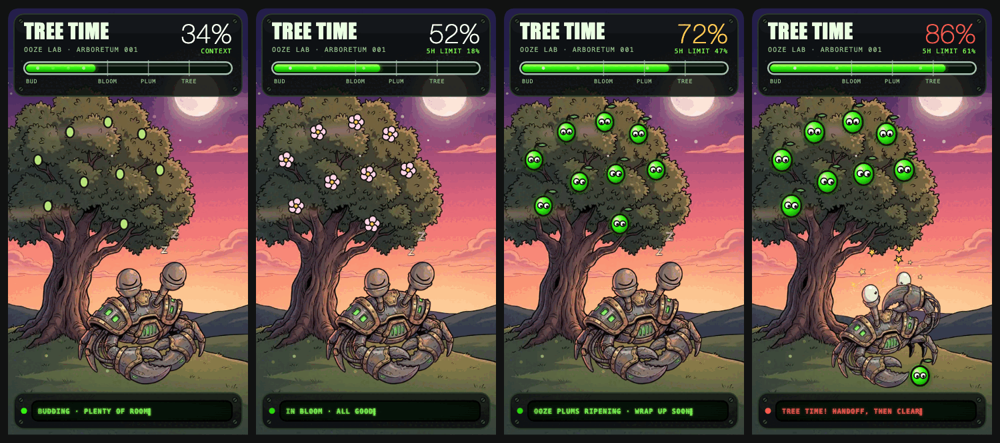

# Tree Time

A tree on a hill that grows fruit as your Claude Code context window fills up. A Servo-Crab naps under it. At 80% a ripe ooze plum drops on the crab's head, it wakes up, and Tree Time tells you to write a handoff and clear the window before Claude starts forgetting things.



## What you get

- **A tree that tracks your context.** Buds below 40%, blossoms to 60%, glowing ooze plums to 80%, then the drop.
- **Two nudges, once each.** A heads-up at 60% with a ding, and the real call at 80% with a submarine dive klaxon. They arm again after you `/clear`.
- **A status line.** 🌱 under 60%, 🌳 from 60%, 🪓 from 80%, plus your 5-hour limit when Claude reports it.
- **Four buttons** under the tree:
  - 🌳 **TREE** runs your `/tree` command if you have one. If not, it asks Claude for a handoff in one code block.
  - 📋 **COPY** copies the newest handoff block from the chat and keeps a copy.
  - 🧹 **CLEAR** runs `/clear`.
  - 🚀 **GO** sends the kept handoff as your first message in the fresh window.
- **A napper you can swap.** The crab is a stand-in. Bring your own character, sounds and words.

The tree draws in the Claude desktop app and the VS Code extension. A terminal session gets the status line and the toasts.

## Install

You need Claude Code.

**1. Add the marketplace.** Type this in a terminal:

```bash
claude plugin marketplace add 1upcreative/tree-time
```

**2. Install the plugin.**

```bash
claude plugin install tree-time@1upcreative-tree-time
```

**3. Start a new Claude Code session.** The plugin loads when a session starts.

That's it. Type `/tree-gauge` to open the tree.

## Commands

- `/tree-gauge` opens the tree and prints your current fill.
- `/tree-gauge test` plays the nudge for your current fill.
- `/tree-gauge preview 85` shows the tree at 85%. Try 80 or more to see the bonk. Your next real reading puts it back.

## Bring your own napper

Tree Time reads the same mascot pack folder as the [Ooze-o-Meter](https://github.com/1upcreative/ooze-o-meter). Add a `tree` section to your pack's `mascot.json`:

```
~/.claude/ooze/mascot/
  mascot.json
  nap/asleep.webp     your character asleep
  nap/bonked.webp     your character just bonked awake
  nap/scene.webp      the painted hill and tree (optional)
  soon.mp3            plays at 60%
  now.mp3             plays at 80%
```

```json
{
  "name": "MY SPECIMEN",
  "tree": {
    "lab": "MY LAB · ARBORETUM 001",
    "pictures": {
      "asleep": "nap/asleep.webp",
      "bonked": "nap/bonked.webp",
      "backdrop": "nap/scene.webp"
    },
    "sounds": { "soon": "soon.mp3", "now": "now.mp3" },
    "toasts": {
      "soon": "🌳 Tree time's coming. Context at {percent}%. Start wrapping up.",
      "now": "🪓 Tree time! Context at {percent}%. Write the handoff, then clear."
    },
    "captions": { "tree-time": "TREE TIME! HANDOFF, THEN CLEAR" },
    "prompt": "Write a handoff for a fresh session in one fenced code block.",
    "napper": { "x": 70, "y": 252, "size": 128, "headX": 138, "headY": 268 }
  }
}
```

Every field is optional. Anything you leave out comes from the crab. `{percent}` in a toast turns into the fill.

Tips for the pictures:

- Use a transparent background. Keep each picture about 260 pixels wide and under 30 KB.
- Draw your character sitting with its back to the left. The tree trunk sits there.
- Keep the same size and pose in `asleep` and `bonked` so the swap looks clean.
- `napper` moves your character on the hill. The scene is 240 by 427. `headX` and `headY` mark where the z's float up and the plum lands.
- `captions` can set `buds`, `blossoms`, `plums` and `tree-time`.

Tree Time looks for a pack in this order: the folder named by `OOZE_MASCOT`, then `~/.claude/ooze/mascot`, then the crab that ships here.

## With the Ooze-o-Meter

If you also run the [Ooze-o-Meter](https://github.com/1upcreative/ooze-o-meter), Tree Time can stack the tree under its lab bench, so one pane shows both. List Tree Time first when you load plugins from folders:

```bash
export CLAUDE_CODE_PLUGIN_DIRS="$HOME/tree-time:$HOME/ooze-o-meter"
```

If the order is the other way round, or you don't have the Ooze-o-Meter, the tree shows on its own tab.

## How it works

Claude Code reports how full the context window is after each turn. Tree Time reads that number, redraws the tree as an SVG, and fires each nudge once. A `/clear`, or a fill that drops under 40% after compaction, arms the nudges again.

## Development

The plugin is a Claude Code function-hooks mod. From the repo root:

```bash
claude plugin validate .
```

```bash
claude plugin test .
```

## License

MIT. See [LICENSE](LICENSE). Made by [1UP Creative](https://1upcreative.co).
